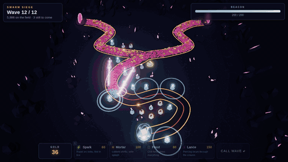

# Pebble3D

<p align="center"><a href="https://pebble3d.github.io/pebble3d/demos/"></a></p>

<p align="center"><b><a href="https://pebble3d.github.io/pebble3d/demos/">Play the demos in your browser</a></b> · <a href="https://pebble3d.github.io/pebble3d/">Site</a> · <a href="skills/README.md">Agent skills</a> · Free to use, including commercially, under $50k annual revenue (<a href="LICENSE">license</a>)</p>

A browser 3D engine: three.js 0.187 (WebGPU, with a WebGL fallback) for rendering, a Rust/WASM Rapier crate for physics, and Gaussian-splat environments. Scenes are plain JSON, validated by a schema, so an agent can write one without reading engine code.

## Agent skills

Ask a coding agent for a game in plain words and it does not start by writing code. The [agent skills](skills/README.md) in `skills/` have it ask at most six short questions (or write down defaults when it cannot ask), write a `BRIEF.md` for you to approve, then build a complete game: title, play, results and restart, with game feel, one committed art direction and a `?demo=1` bot. It verifies the game with tests and screenshots it has looked at before it reports done.

Start with [skills/make-a-game/SKILL.md](skills/make-a-game/SKILL.md), which runs the others in this order: interview, brief, scaffold, build, game feel, art pass, complete loop, verify. Claude Code, Cursor and GitHub Copilot discover the copies in `.claude/skills/`; other agents find them through [AGENTS.md](AGENTS.md) and [llms.txt](llms.txt). Overview: https://pebble3d.github.io/pebble3d/build-with-ai/skills/.

## Quickstart

Requires Node 22.6 or newer (the Node scripts use `--experimental-strip-types`; the avatar GLB hash was verified on Node 25.2.1, see `.nvmrc`), pnpm, a Rust toolchain with the `wasm32-unknown-unknown` target, and `wasm-bindgen-cli` 0.2.130. `pnpm shot` also needs a Chromium for Playwright: run `pnpm exec playwright install chromium` once.

```bash
pnpm i && pnpm build:wasm && pnpm fetch-assets && pnpm dev
```

`pnpm dev` serves the playground with Vite (default port 5173). Open `/?scene=showcase` (a splat scene with a realistic human character). Other scenes: `showcase-robot` (the same scene with the stylised robot), `studio`, `outdoor`, `det`, `showcase-badsplat`.

Playground URL params: `scene`, `mode=realtime|fixed`, `ticks`, `backend=webgpu|webgl`, `cam`, `overlay`, `script`, `splat`, `debug=splatOnly`. The stats overlay toggles with the backtick key.

## Docs for humans and LLMs

Start with [docs/getting-started.md](docs/getting-started.md), then browse [docs/](docs/) (scene and API reference, cookbook, verification, troubleshooting). Coding agents: read [AGENTS.md](AGENTS.md). LLMs can discover everything from [llms.txt](llms.txt), or load [llms-full.txt](llms-full.txt) in one go.

## Showcase games

Original games, each built to show off one strength of the engine. Each one plays a full loop, includes an autoplayer bot (`?demo=1`), and has unit tests. Run `pnpm --filter <app> dev`, then open the port listed below. Each game's README (`apps/<app>/README.md`) covers its controls, URL params, numbers and known issues. Play them online at https://pebble3d.github.io/pebble3d/demos/.

| Game           | App              | Port | What it shows off                                                                                                                                            |
| -------------- | ---------------- | ---- | ------------------------------------------------------------------------------------------------------------------------------------------------------------ |
| Ronin Outpost  | `katana-defense` | 5180 | Toon-shaded ninja katana horde defence: Rocketbox avatars, procedural combat animation with IK, skinned zombie crowds, and the opt-in `post.style: "toon"`   |
| Breakpoint     | `breakpoint`     | 5210 | Physics demolition with 838 to 1,344 Rapier bodies per site, run in a Web Worker on the `fast` build, plus a deterministic replay of your best shot          |
| Ghostline      | `ghostline`      | 5220 | Marble time trials with ghosts recomputed live from your inputs (not recordings), PBR materials and JSON courses                                             |
| Field Notes    | `field-notes`    | 5231 | Photography in two real Gaussian-splat captures: splat/mesh compositing, a third-person controller, and depth of field                                       |
| Rockfall       | `rockfall`       | 5240 | Survival against waves driven by Rust-side seeded spawners, with up to 1,800 live bodies                                                                     |
| Chain Reaction | `chain-reaction` | 5250 | A contraption puzzle whose levels are JSON scenes; `pnpm --filter chain-reaction verify` replays each solution headless in Node and matches the browser hash |
| Lanternfall    | `lanternfall`    | 5260 | A stealth heist in a keep generated from a seed as schema-valid scene JSON, with raycast guard perception and `accel` characters                             |
| Ringout        | `ringout`        | 5270 | Local multiplayer sumo: torque and impulse-driven orbs on a collapsing arena of kinematic columns, with an instant replay checked against the live hash      |
| Skyrun         | `skyrun`         | 5280 | A parkour time trial: the character controller riding sliding, spinning and orbiting platforms (`ridePlatforms`), with a re-simulated ghost                  |
| Pebble Garden  | `pebble-garden`  | 5290 | A physics sandbox and level editor: gardens export as schema-valid scene JSON, import with readable errors, and play and rewind exactly                      |
| Swarm Siege    | `swarm-siege`    | 5300 | Tower defence against thousands of instanced enemies simulated in a Web Worker, with raycast camera picking and spawner debris                               |
| Drift Drone    | `drift-drone`    | 5310 | An FPV drone flown by thrust and torque impulses through a Gaussian-splat capture, with a re-simulated ghost and a depth-of-field photo finish               |

Linux Chromium needs WebGPU switched on: `chromium --enable-unsafe-webgpu --enable-features=Vulkan --use-angle=vulkan`. If WebGPU isn't available, `?backend=webgl` uses the WebGL fallback.

## A minimal scene

```json
{
	"version": 1,
	"environment": { "preset": "studio", "ground": {} },
	"prefabs": {
		"ball": {
			"mesh": { "primitive": "sphere" },
			"body": { "restitution": 0.5 }
		}
	},
	"entities": [
		{ "id": "b1", "prefab": "ball", "transform": { "position": [0, 4, 0] } }
	]
}
```

Save it as `apps/playground/scenes/mine.json` and open `/?scene=mine`.

## For agents

[`packages/sdk/scene.schema.json`](packages/sdk/scene.schema.json) is the JSON Schema for scene files (regenerate with `pnpm --filter @pebble3d/sdk schema`). Point `$schema` at it and validate before running. The zod source is `packages/sdk/src/schema.ts`. In a page, `window.__pebble3d` exposes `ready`, `done`, `stats()`, `stateHash()`, `setCamera()`, `player()` and `position()`.

## Screenshots: `pnpm shot`

```bash
pnpm shot --scene showcase --cam hero --backend webgpu --overlay
```

It builds the app (default the playground), serves it on a free port, renders in fixed-tick mode in Chromium and writes `artifacts/shots/<scene>-<cam>-<backend>-<w>x<h>.png` plus a `.json` sidecar (`adapterInfo`, `stats`, `stateHash`, `tick`, console).

| Flag                                          | Meaning                                                                                                                                                                                                                                                                  |
| --------------------------------------------- | ------------------------------------------------------------------------------------------------------------------------------------------------------------------------------------------------------------------------------------------------------------------------ |
| `--scene <name>`                              | A file in `apps/playground/scenes/`. Required for the playground (the default app); optional with `--app`.                                                                                                                                                               |
| `--cam <preset>`                              | A camera preset, or `controller`. Default: the renderer's (`hero`, else the first preset).                                                                                                                                                                               |
| `--backend webgpu\|webgl`                     | Default `webgpu`. Fails if that backend is not the one that ran.                                                                                                                                                                                                         |
| `--size WxH` / `--resize WxH`                 | Viewport size (default 1280x720) / resize after load (not with `--sequence`).                                                                                                                                                                                            |
| `--ticks <n>`                                 | Sim ticks to run before capture (default 120).                                                                                                                                                                                                                           |
| `--script <name>`                             | Scripted player input: `walk-forward`, `walk-into-crates`, `walk-to-bounds`, `walk-side`, `sprint-side`, `jump`, `jump-side` (see `SCRIPTS` in `apps/playground/src/main.ts`).                                                                                           |
| `--sequence <n>[:<every>]`                    | Capture `n` frames, one every `<every>` ticks (default 1), from tick `--ticks`: `<name>-f000.png`... plus `<name>.webp`, an animated WebP (30 fps for every=1, else real time). `--fps <n>` / `--scale <f>` / `--no-frames` override the rate, downscale, drop the PNGs. |
| `--overlay`                                   | Show the stats overlay in the shot.                                                                                                                                                                                                                                      |
| `--splat <url>` / `--debug splatOnly`         | Override the splat / draw only the splat.                                                                                                                                                                                                                                |
| `--allow-console-error "<substring>[:count]"` | Permit an expected console error, optionally with an exact count.                                                                                                                                                                                                        |
| `--no-build` / `--headed`                     | Skip the build / show the browser.                                                                                                                                                                                                                                       |
| `--app <dir>` / `--param key=value`           | Capture another app under `apps/` (then `--scene` is optional) / pass extra URL params.                                                                                                                                                                                  |
| `--out <dir>` / `--name <basename>`           | Output directory (inside `artifacts/`) / file basename.                                                                                                                                                                                                                  |
| `--timeout <s>` / `--port <n>`                | Per-wait timeout (default 60) / serve the preview on a fixed port.                                                                                                                                                                                                       |

It exits 1 on any console warning or error not in `scripts/shot/console-allowlist.json` or an `--allow-console-error`, on a missing or software (SwiftShader) adapter, or if a wait (load, `__pebble3d.done`, each sequence frame) exceeds `--timeout` (default 60 s).

## Tests and benchmarks

```bash
cargo test -p engine-core --features deterministic
cargo test -p engine-core --no-default-features --features fast
pnpm -r test && pnpm -r typecheck && pnpm lint
node --experimental-strip-types packages/sdk/test/determinism.mjs --expect "$(cat packages/sdk/test/fixtures/det-hash.txt)"
pnpm shot --scene det --cam hero --backend webgpu --ticks 1000
node -e "const s=require('./artifacts/shots/det-hero-webgpu-1280x720.json'); const h=require('fs').readFileSync('packages/sdk/test/fixtures/det-hash.txt','utf8').trim(); process.exit(s.stateHash===h && s.tick===1000 ? 0 : 1)"
node --experimental-strip-types packages/sdk/test/bench.mjs
```

`engine-core` defaults to the `deterministic` feature (Rapier enhanced-determinism, bit-identical state hash across runs); `fast` is plain Rapier with WASM SIMD. The Node scripts need `--experimental-strip-types` because they import TypeScript sources.

Bench (10,000 ticks at 1/60 s, 300 active ticks sampled, real-time multiple of the sim step, one run on an AMD RDNA 3 laptop; numbers vary run to run):

| Build         | Bodies | Active ticks (x real time) | Full 10k run (x real time) |
| ------------- | ------ | -------------------------- | -------------------------- |
| deterministic | 100    | 231                        | 2890                       |
| deterministic | 500    | 109                        | 1623                       |
| fast          | 100    | 368                        | 2817                       |
| fast          | 500    | 149                        | 1608                       |

"Full run" includes the stretch where bodies are asleep.

## Known limitations

- One game per page: `Game.dispose` does not exist yet (planned).
- Determinism is verified on V8 (Node and Chromium) only.
- The derived splat hash was verified on one machine. If `fetch-assets` reports a hash mismatch elsewhere, that is the cause.
- The splat is a drone capture, so grass is soft and blurry up close.
- On `showcase-robot`, the walk clip's toe dips about 6 cm below the ground plane.
- On `showcase-robot`, there is no fall animation clip; falling reuses the jump clip.
- On the human, residual foot slip is about 15% at walk and 24% at sprint, inherited from the source clips.
- The human avatar (`rocketbox-male-adult-16.glb`) builds only on linux-x64, because the pinned KTX-Software binary is linux-x64 only. On other platforms `pnpm fetch-assets` reports that asset as failed; use `?scene=showcase-robot`.
- The overlay's draw calls and triangles count every pass (AO prepass, shadow cascades, bloom, SMAA), not just the main scene.
- Screenshots repeat to RMSE < 0.002 (under 0.1% of pixels more than 8/255 off), not byte for byte.
- `fps` and `frameMs` are wall-clock. In fixed mode the sim time is not the wall time.

## Assets and credits

Large assets are not committed; `pnpm fetch-assets` downloads them per `apps/playground/assets.manifest.json`. Licenses and attribution (Poly Haven HDRI, CC BY 4.0 splat scene, Quaternius robot, and the showcase character: Microsoft Rocketbox `Male_Adult_16`, MIT, Copyright (c) 2020 Microsoft) are in [`apps/playground/public/assets/LICENSES.md`](apps/playground/public/assets/LICENSES.md). The full Rocketbox licence text is in [`Microsoft-Rocketbox-MIT.txt`](apps/playground/public/assets/licenses/Microsoft-Rocketbox-MIT.txt). The Basis transcoder served at `/basis/` is Apache-2.0; its notice ships in `dist/basis/`.

## Roadmap

- `packages/mcp-server`: an MCP server for authoring, running and screenshotting scenes.
- A headless CLI runner.
- Spatial-query and diagnostics APIs for agents.
- A full studio HUD beyond the stats overlay (`packages/studio-overlay`).
- `scripts/splat-collider`: generate physics geometry from a splat capture.
- Tighter fast-build performance at 500 bodies.

## License

Pebble3D is source-available under the [Pebble3D Engine License](LICENSE), © 2026 RJV Solutions.

- **Free**, including commercial use, for organizations with under **USD $50,000** in annual revenue plus funding (trailing 12 months, counted across the whole organization and its affiliates).
- **At or above $50,000**, a paid commercial license from RJV Solutions is required. There is a 60-day grace period after crossing the threshold.
- Players of games built with Pebble3D never need a license.
- Third-party dependencies and demo assets (three.js MIT, Rapier Apache-2.0, CC BY 4.0 / CC0 assets) keep their own licenses.
